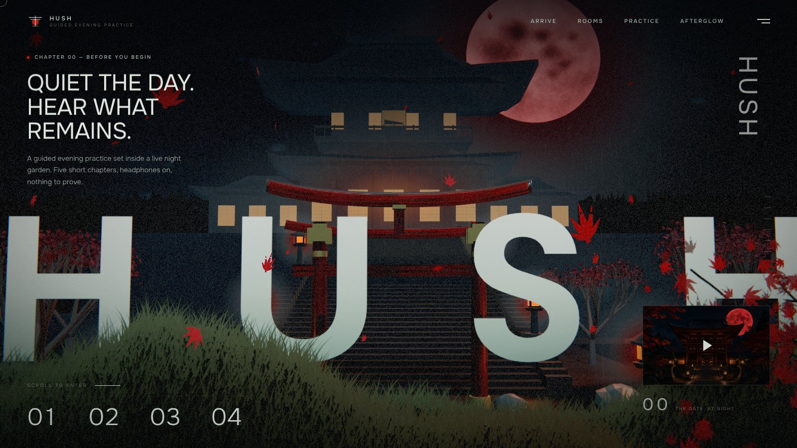

<p align="center">
  
</p>

# Hush

**Quiet the day. Hear what remains.**

<p>
  
  
  
</p>

A concept website for a guided evening practice: five short chapters set inside a live, scroll-driven night garden rendered with Three.js.

## Credits

**This project would not exist without the work of Meng To and the ThreeUI Community.**

- **Original design and code:** the **[Kage Landing Page](https://threeui.com/kage-landing-page)** from **[ThreeUI Community](https://github.com/MengTo/threeui)** by **[Meng To](https://github.com/MengTo)**. Hush was made because I loved this original work. Please visit and support the original at https://threeui.com. The page structure, scroll-driven scenes, WebGL night-garden world, animations and all image assets in this repo are his work.
- **Licence:** ThreeUI Community is released under the **MIT License**, Copyright (c) 2026 Meng To. The full licence text is kept in [`THIRD_PARTY/THREEUI-LICENSE`](THIRD_PARTY/THREEUI-LICENSE), as the licence requires.
- **Fonts:** Fragment Mono, Instrument Serif, Newsreader, Lexend and Onest, each under the SIL Open Font License 1.1. See [`THIRD_PARTY/FONT-LICENSES.md`](THIRD_PARTY/FONT-LICENSES.md).
- **Three.js:** bundled runtime under the MIT License, upstream headers retained.
- Other notices: [`THIRD_PARTY/ASSET-LICENSES.md`](THIRD_PARTY/ASSET-LICENSES.md) and [`THIRD_PARTY/THIRD_PARTY_NOTICES.md`](THIRD_PARTY/THIRD_PARTY_NOTICES.md).

### What was changed in Hush

Only the text, naming, section copy and footer were rewritten for a new concept (a guided evening practice). Everything else is still the original Kage work. The exact edits are in [`scripts/build-page.mjs`](scripts/build-page.mjs).

Hush adaptation by [Lamia Kajal](https://github.com/lamiakajal), with help from Claude (Anthropic) for planning and the text-rewrite script.

This is an independent concept project and is not affiliated with or endorsed by ThreeUI or Meng To.

## Run it

You need [Node.js](https://nodejs.org/).

```bash
npm install
npm run dev
```

Then open the local URL Vite prints (usually http://localhost:5173). The page loads automatically.

All required files, including the Three.js runtime, fonts and images, are already in `public/hush/`.

## Project layout

- `public/hush/index.html`: the Hush page
- `public/hush/secret-pathways-assets/`: Three.js, fonts and images (from ThreeUI)
- `docs/IMAGE-PROMPTS.md`: prompts for replacing the images with original artwork
- `scripts/build-page.mjs`: rewrites ThreeUI's `kage.html` into the Hush page
- `scripts/setup.mjs`: optional, rebuilds `public/hush/` from a local ThreeUI clone
- `THIRD_PARTY/`: upstream licences

## Status

Concept project. The images are still ThreeUI's original Kage artwork; replacing them with original imagery is the next step.

## Licence

The ThreeUI-derived code and assets stay under the MIT License of the original author (see `THIRD_PARTY/THREEUI-LICENSE`). The Hush text and copy are by Lamia Kajal.
